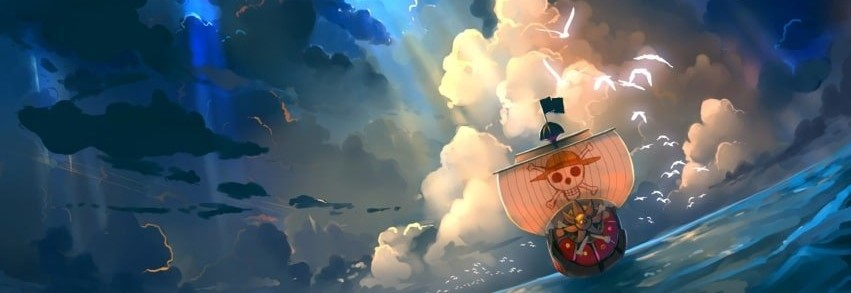

# One Piece — My All-Time Favorite Series

> "I don't want to conquer anything. I just think the guy with the most freedom in this whole ocean... is the Pirate King!"
>
> — **Monkey D. Luffy**, Captain of the Straw Hat Pirates



[](https://myanimelist.net/anime/21/One_Piece)
[](https://www.crunchyroll.com/series/GRMG8ZQZR/one-piece)
[](#quick-facts)
[](#quick-facts)

---

## Table of Contents

1. [Quick Facts](#quick-facts)
2. [Why I Love It](#why-i-love-it)
3. [My Top 3 Arcs](#my-top-3-arcs)
4. [The Straw Hat Crew](#the-straw-hat-crew)
5. [Devil Fruit Data](#devil-fruit-data)
6. [Watch Order](#watch-order)
7. [Favorite Quotes](#favorite-quotes)
8. [Bucket List](#bucket-list)
9. [Fun Facts](#fun-facts)
10. [Sources](#sources)

---

## Quick Facts

| Detail | Information |
| :--- | :--- |
| **Creator** | Eiichiro Oda |
| **Studio** | Toei Animation |
| **First aired** | October 20, 1999 |
| **Episodes** | 1,100+ and still ongoing |
| **Genre** | Adventure · Fantasy · Comedy · Drama |
| **Core theme** | Freedom, dreams, and found family |
| **My rating** | ⭐⭐⭐⭐⭐ 10/10 |

## Why I Love It

I started watching **One Piece** in Grade 6, and it is still the *only* series that can make me laugh and cry in the same episode. On the surface it looks like a simple pirate adventure, but it is really a 27-year story about freedom, grief, and refusing to give up on the people you love.

It is ~~just a cartoon about pirates~~ actually one of the most carefully planned stories ever written. Three things keep me coming back:

- **World-building** — every island has its own politics, culture, and history. Nothing is filler.
- **Character writing** — even the villains get a backstory that explains *why* they broke.
- **Emotional payoff** — jokes set up in episode 30 land as gut punches in episode 900.

### Common Misconceptions

- ~~One Piece is only for kids.~~ It deals with slavery, corruption, grief, and loss.
- ~~You need to watch 1,000 episodes to enjoy it.~~ The first arc is already complete and satisfying.
- ~~It is only about fighting.~~ Most arcs are solved by *choices*, not by stronger punches.

> **Spoiler warning**
> The section below mentions arcs and events, but no major character deaths.

## My Top 3 Arcs

1. **Water 7 / Enies Lobby** — the crew finally declares war on the World Government to save one member.
   - Best moment: the flag burning on the rooftop.
   - Why it matters: it turns a adventure story into a story about *institutions*.
2. **Marineford** — the single biggest turning point in the whole series.
   - Best moment: Whitebeard's final declaration.
   - Why it matters: it shows that being strong is not the same as being free.
3. **Wano Country** — the payoff of 20 years of setup.
   - Best moment: Gear 5.
   - Why it matters: the art style, music, and animation all level up at once.

## The Straw Hat Crew

| # | Character | Role | Devil Fruit |
| :-: | :--- | :--- | :--- |
| 1 | Monkey D. Luffy | Captain | Hito Hito no Mi, Model: Nika |
| 2 | Roronoa Zoro | Combatant | — |
| 3 | Nami | Navigator | — |
| 4 | Usopp | Sniper | — |
| 5 | Sanji | Cook | — |
| 6 | Tony Tony Chopper | Doctor | Hito Hito no Mi |
| 7 | Nico Robin | Archaeologist | Hana Hana no Mi |
| 8 | Franky | Shipwright | — |
| 9 | Brook | Musician | Yomi Yomi no Mi |
| 10 | Jinbe | Helmsman | — |

## Devil Fruit Data

```json
{
  "captain": "Monkey D. Luffy",
  "devil_fruit": "Gomu Gomu no Mi",
  "true_name": "Hito Hito no Mi, Model: Nika",
  "type": "Mythical Zoan",
  "awakened": true,
  "dream": "To become the Pirate King",
  "crew_size": 10,
  "home_base": "Thousand Sunny"
}
```

The fruit is named after a *rubber* power, but the World Government renamed it to hide its real identity — one of my favorite twists in the series.

## Watch Order

```text
SAGA                  EPISODES     NOTE
East Blue             1 - 61       Start here
Alabasta              62 - 135     First big arc
Skypiea               136 - 206    Optional but fun
Water 7 / Enies Lobby 207 - 325    Do not skip
Thriller Bark         326 - 384    Comedy arc
Marineford            457 - 516    Peak drama
Fish-Man Island       517 - 574    World-building
Dressrosa             629 - 746    Long but worth it
Whole Cake Island     783 - 877    Sanji's arc
Wano                  890 - 1085   Best animation
Egghead               1086 - now   Currently airing
```

> **Tip:** if 1,100 episodes feels too long, read the manga from Chapter 1 instead — the pacing is much faster.

My most re-watched episode so far is episode 1,012[^1] — the animation there is on another level.

## Favorite Quotes

> "If you don't take risks, you can't create a future."

> "No matter how deep the night, it always turns to day, eventually."

> "When do you think a man dies? When he is forgotten."

## Bucket List

- [x] Watch every canon arc
- [x] Read the manga up to the current chapter
- [x] Buy a Straw Hat keychain
- [ ] Visit the One Piece store in Japan
- [ ] Watch *One Piece Film: Red* in a cinema
- [ ] Finish the whole series before the final chapter drops

## Fun Facts

<details>
<summary><strong>Click to reveal: the numbers behind One Piece</strong></summary>

- Eiichiro Oda has been serializing the manga since **July 19, 1997**.
- The manga holds the Guinness World Record for the most copies published for the same comic book series by a single author.
- Luffy's birthday, **May 5**, comes from the Japanese wordplay *go-mu* (rubber).
- The anime has over **1,100 episodes** and more than **15 movies and TV specials**.

</details>

<details>
<summary><strong>Click to reveal: my favorite opening song</strong></summary>

*"We Are!"* by Hiroshi Kitadani — the original opening. It has been re-recorded several times, but the 1999 version still hits differently.

</details>

## Sources

- [One Piece on MyAnimeList](https://myanimelist.net/anime/21/One_Piece)
- [One Piece on Crunchyroll](https://www.crunchyroll.com/series/GRMG8ZQZR/one-piece)
- [Official One Piece website (Japan)](https://one-piece.com/)
- [One Piece Wiki — Fandom](https://onepiece.fandom.com/wiki/One_Piece_Wiki)

---

## About This Repository

This repository was created for **CITE1008 — Application Development**, Pre-Final Performance Task (Individual Work).

It contains my `README.md` about my favorite series, written with different Markdown elements: headings, tables, links, images, badges, lists, task lists, blockquotes, code blocks, footnotes, and collapsible sections.

**Author:** Alexis Polidario
**Section:** BSIT 3E
**Date:** November 2026

[^1]: Episode 1,012 is my personal favorite — the animation and the soundtrack finally matched the manga panel for panel.
